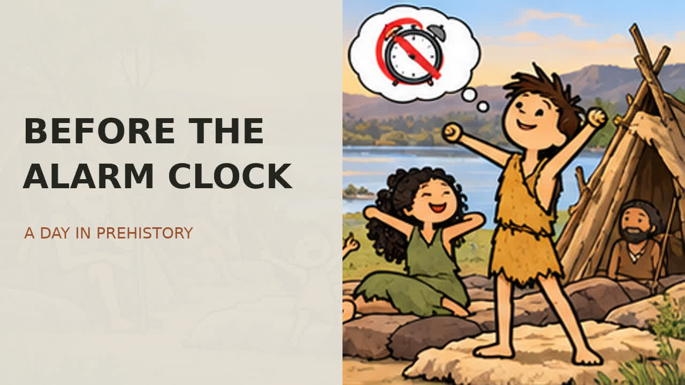

# Before the Alarm Clock

Video tiếng Anh về một ngày của người săn bắt – hái lượm.

- Thời lượng: 4 phút 12 giây.
- Định dạng: MP4, H.264/AAC, 1280 × 720.
- Giọng đọc: Kokoro, tiếng Anh Mỹ, `am_michael`.
- 12 cảnh minh họa, chuyển động máy quay và phụ đề tiếng Anh gắn trong video.
- Tranh minh họa có chuyển cảnh; nhân vật chưa có hoạt hình tay chân riêng.

## Xem hoặc tải video

**[Tải video MP4 tại đây](https://raw.githubusercontent.com/tai23082004l02-svg/YTB-ng-i-que/main/videos/before-the-alarm-clock/Before-the-Alarm-Clock.mp4)**

Nếu GitHub không phát video trực tiếp, hãy mở liên kết trên để tải về rồi xem bằng trình phát video trên điện thoại hoặc máy tính.

[Trang tệp video trên GitHub](Before-the-Alarm-Clock.mp4) · [Phụ đề SRT](subtitles.srt) · [Kịch bản](script.txt) · [Tiêu đề và mô tả YouTube](youtube-description.txt)

## Nội dung và nguồn tham khảo

Kịch bản và hình minh họa được tạo mới; đây là một ngày giả định tổng hợp, không phải tái hiện một cộng đồng khảo cổ cụ thể. Đời sống săn bắt – hái lượm thay đổi theo nơi chốn và thời kỳ.

- [Smithsonian: Social Life](https://humanorigins.si.edu/human-characteristics/social-life)
- [Smithsonian: Stone Tools](https://humanorigins.si.edu/evidence/behavior/stone-tools)
- [Smithsonian: Humans Change the World](https://humanorigins.si.edu/human-characteristics/humans-change-world)

Video sử dụng hình minh họa và giọng đọc do AI tạo. Không có nhạc của bên thứ ba.
