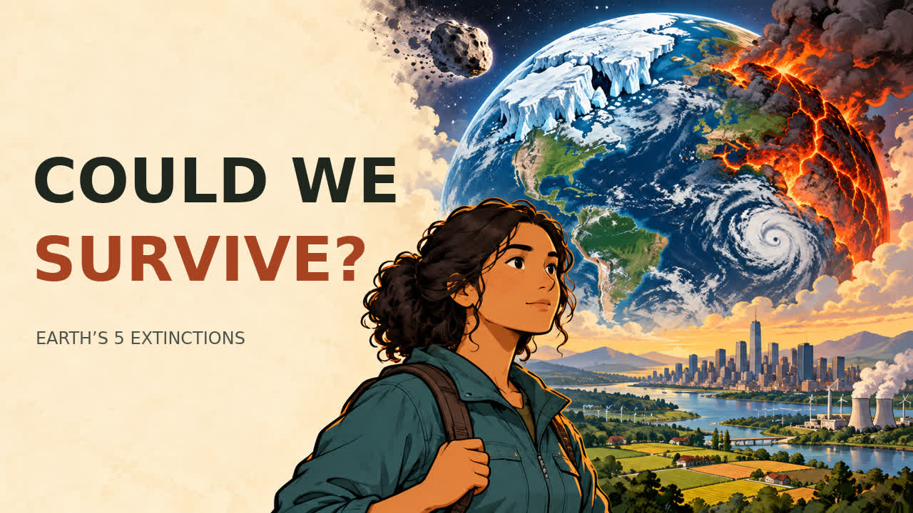

# Could Humanity Survive Earth's Five Mass Extinctions?

**[Xem hoặc tải MP4 đầy đủ — 34 phút 30 giây](https://raw.githubusercontent.com/tai23082004l02-svg/YTB-ng-i-que/main/videos/could-we-survive/Could-We-Survive.mp4)**

Video khoa học bằng tiếng Anh Mỹ, đưa những cơ chế khủng hoảng của Big Five vào các tình huống giả định về thế giới hiện đại. Phân biệt con người sống sót, các quần thể tiếp tục tồn tại và nền văn minh công nghiệp còn vận hành.

## Bản hoàn chỉnh

- **34:30**, **28 phần**, gần **5.000 từ tiếng Anh**.
- **371 hình khác nhau**, đổi mỗi khoảng **5,3–5,8 giây**; 384 hình nguồn trước tuyển chọn.
- Hình đứng yên, cắt thẳng; không zoom, pan, rung, thanh tiêu đề hoặc bộ đếm cảnh.
- Giọng nam Mỹ Kokoro `am_michael`; **681 đoạn phụ đề** tiếng Anh, chữ có viền tối ở phía dưới, không dải nền đen cố định.
- MP4 H.264/AAC, 1280 × 720, 24 fps, có 28 chương trong metadata.
- Đã giải mã kiểm tra toàn bộ video và âm thanh; âm lượng mã hóa đo được -16,76 LUFS, true peak -1,70 dBTP.
- Đây là video minh họa tĩnh có đổi cảnh, không phải hoạt hình chuyển động tay chân riêng.

Nếu GitHub không phát trực tiếp, tải MP4 về để xem trên máy tính hoặc điện thoại.

## Bộ đăng YouTube sẵn dùng

**Tiêu đề đề xuất:** Could We Survive Earth's 5 Mass Extinctions?

- **[Tải bộ đăng ZIP](youtube-upload-kit.zip)** — metadata, thumbnail, phụ đề và hướng dẫn; MP4 tải riêng ở trên.
- [Hướng dẫn và các tệp để sao chép](youtube-upload-kit/README.md)
- [Mô tả có 28 mốc chương](youtube-upload-kit/description.txt)
- [Thumbnail COULD WE SURVIVE?](youtube-upload-kit/thumbnail-main.jpg)
- [Cài đặt đăng đề xuất](youtube-upload-kit/UPLOAD_SETTINGS.md)

## Kịch bản, nguồn và dữ liệu dựng

- [Kịch bản đầy đủ](script.txt)
- [Phụ đề SRT](subtitles.srt)
- [Nguồn tham khảo và giới hạn suy luận](SOURCES.md)
- [Ghi chú sản xuất](production-notes.md)
- [Kết quả kiểm tra kỹ thuật](validation-summary.json)
- [Dữ liệu sản xuất và ảnh nguồn](project/README.md)

Các phần lần lượt xem xét: khí hậu lạnh và di cư; đại dương mất dưỡng khí; Đại Diệt Vong và giới hạn nhiệt; khủng hoảng núi lửa kéo dài; Chicxulub, phòng thủ thiên thạch và nguồn lương thực khi ánh sáng suy giảm; cuối cùng là khủng hoảng đa dạng sinh học và ý nghĩa của “đại tuyệt chủng thứ sáu”.

Bằng chứng cổ đại và các kịch bản hiện đại được phân biệt trong lời kể. Không có tỷ lệ sống sót tự bịa, ngày tận thế được dự báo, hoặc cam kết rằng một công nghệ có thể cứu chắc toàn bộ nhân loại. Các hình và sơ đồ là phục dựng nghệ thuật/khái niệm, không phải dữ liệu nghiên cứu gốc hoặc hình ảnh một thảm họa thật đang xảy ra.

Trợ lý bàn giao trên GitHub cùng bộ đăng; không có thao tác đăng hoặc lên lịch YouTube tự động.

