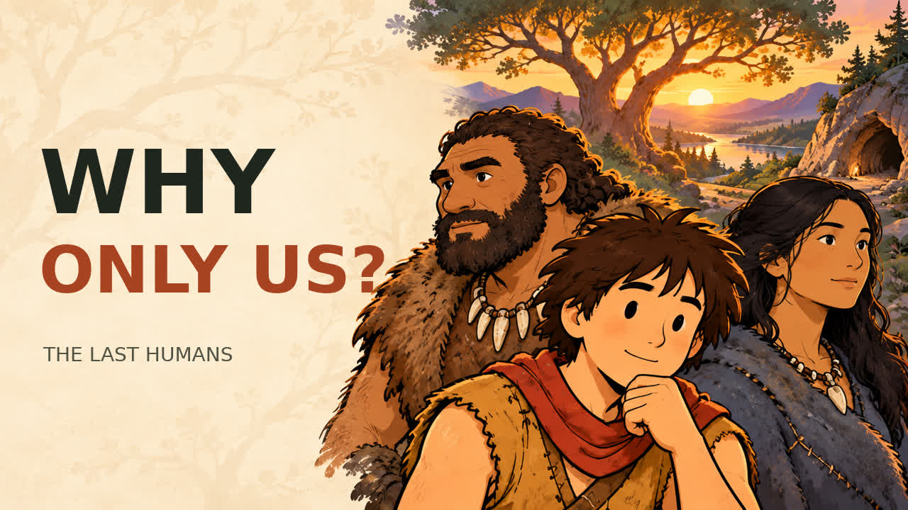

# Earth Once Had Many Human Species. Why Are We the Only Ones Left?

Video tiếng Anh Mỹ về các nhánh người cổ, sự pha trộn tổ tiên và những giả thuyết giải thích vì sao chỉ Homo sapiens còn sống đến hôm nay.

**[Mở hoặc tải video MP4](https://raw.githubusercontent.com/tai23082004l02-svg/YTB-ng-i-que/main/videos/the-last-humans/The-Last-Humans.mp4)**

Nếu trình duyệt không phát trực tiếp, hãy tải MP4 về để xem bằng trình phát video trên máy tính hoặc điện thoại.

## Bản hoàn chỉnh

- Thời lượng khoảng **24 phút 45 giây**, gồm **20 phần**.
- Kịch bản mới, khoảng **3.600 từ tiếng Anh**.
- **268 hình khác nhau**, đổi hình mỗi khoảng **5,2–5,7 giây**.
- Hình đứng yên hoàn toàn: **không zoom, pan, rung máy, thanh tiêu đề hoặc bộ đếm cảnh**.
- Giọng nam Mỹ Kokoro `am_michael`, phụ đề tiếng Anh phía dưới, không có dải nền đen cố định.
- MP4 H.264/AAC, 1280 × 720, 24 fps, có đánh dấu chương để điều hướng trong trình phát hỗ trợ.
- Đây là video minh họa tĩnh có đổi cảnh; nhân vật không có hoạt hình tay chân riêng.

## Tệp đi kèm

- [Kịch bản đầy đủ](script.txt)
- [Phụ đề SRT](subtitles.srt)
- [Thumbnail](thumbnail.jpg)
- [Tiêu đề, mô tả và mốc chương YouTube](youtube-description.txt)
- [Nguồn tham khảo và giới hạn bằng chứng](SOURCES.md)
- [Ghi chú sản xuất](production-notes.md)
- [Kết quả kiểm tra kỹ thuật](validation-summary.json)
- [Kế hoạch hình ảnh và dữ liệu dựng](project/)
- [24 bộ ảnh nguồn, tổng cộng 288 hình trước khi tuyển chọn](project/assets/)

## Nội dung

Video phân biệt loài người với bộ tộc, giới thiệu sapiens, Neanderthal, Denisovan, người Flores và các nhánh khác; sau đó xem xét khí hậu, quần thể nhỏ, cạnh tranh, kết nối xã hội và sự hòa nhập thông qua sinh con chung. Không trình bày một giả thuyết đơn lẻ như lời giải đã được chứng minh cho mọi nhóm.

Những nhóm này không phải tất cả đều sống cùng lúc, ở cùng nơi hoặc từng gặp nhau. Các chân dung, trang phục và cảnh sinh hoạt là phục dựng nghệ thuật; đặc biệt, diện mạo Denisovan còn nhiều bất định. Sơ đồ là minh họa khái niệm, không phải dữ liệu nghiên cứu gốc. Tất cả quần thể người hiện nay đều là Homo sapiens; tỷ lệ tổ tiên cổ không phải một thứ hạng giữa con người.

Kịch bản và hình được tạo mới; lời đọc được tổng hợp bằng Kokoro. Không dùng nhạc của bên thứ ba. Video chưa được đăng lên YouTube.

