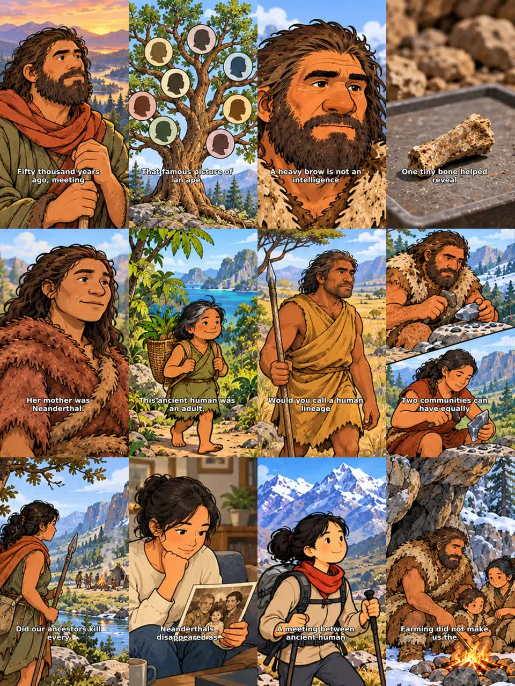

# The Last Humans — 12 Shorts

**[Tải trọn bộ 12 video và thông tin đăng](all-12-shorts.zip)**

12 tập độc lập cho **The Long Wonder**, lời dẫn và giọng Kokoro tiếng Anh Mỹ mới. Dọc **720×1280,9:16, 24 fps**, khoảng **57–64 giây/tập**; tổng **12:12**. **252 hình chọn**,379 đoạn phụ đề. Cảnh đơn giản 2–3 giây, sơ đồ/giải thích 4–5 giây; hình đứng yên, không zoom/pan/rung, không header hoặc bộ đếm.

| Tập | Chủ đề / tiêu đề | Thời lượng | Cảnh | Tải video |
| --- | --- | --- | --- | --- |
| 01 | [We Weren’t Always the Only Humans](01-other-humans/README.md) | 58.96s | 20 | [MP4](01-other-humans/video.mp4) |
| 02 | [Human Evolution Was Never a Straight Line](02-evolution-tree/README.md) | 57.04s | 20 | [MP4](02-evolution-tree/video.mp4) |
| 03 | [Neanderthals Weren’t Stupid](03-neanderthal-skills/README.md) | 60.79s | 21 | [MP4](03-neanderthal-skills/video.mp4) |
| 04 | [A Tiny Bone Revealed a Hidden Human Lineage](04-denisovan-bone/README.md) | 62.29s | 21 | [MP4](04-denisovan-bone/video.mp4) |
| 05 | [Her Mother Was Neanderthal. Her Father Was Denisovan.](05-two-parents/README.md) | 60.33s | 21 | [MP4](05-two-parents/video.mp4) |
| 06 | [An Adult Human Just 3½ Feet Tall](06-flores-adult/README.md) | 59.71s | 21 | [MP4](06-flores-adult/video.mp4) |
| 07 | [This Human Lineage Lasted Over a Million Years](07-erectus-time/README.md) | 56.92s | 20 | [MP4](07-erectus-time/video.mp4) |
| 08 | [Being Smart Wasn’t Enough to Survive](08-small-populations/README.md) | 63.54s | 22 | [MP4](08-small-populations/video.mp4) |
| 09 | [Did We Kill the Other Humans?](09-competition/README.md) | 63.33s | 22 | [MP4](09-competition/video.mp4) |
| 10 | [You May Carry Neanderthal DNA](10-ancestry/README.md) | 64.40s | 21 | [MP4](10-ancestry/video.mp4) |
| 11 | [An Ancient Human Inheritance Helps at High Altitude](11-altitude/README.md) | 61.50s | 21 | [MP4](11-altitude/video.mp4) |
| 12 | [Farming Didn’t Make Us the Last Humans](12-before-farming/README.md) | 62.67s | 22 | [MP4](12-before-farming/video.mp4) |

Mỗi thư mục có video, ảnh bìa từ khung hình thật, kịch bản, SRT, tiêu đề, mô tả, tags, bình luận ghim, tiêu đề thay thế và metadata.

**Thứ tự gợi ý:** 05→06→10→03→04→01→02→07→08→09→11→12. Đây là thứ tự đề xuất, chưa lên lịch. [Kế hoạch CSV](upload-plan.csv) · [Hướng dẫn đăng](UPLOAD_GUIDE.md).

[Đọc nguồn và giới hạn khoa học](SOURCES.md) · [Ghi chú sản xuất](PRODUCTION.md) · [Kiểm tra kỹ thuật](validation-summary.json). Hình dọc được tái bố cục dựa trên phong cách/nhân vật nguồn; phim dài không bị thay đổi. Không có tập nào tự đăng lên YouTube.

[Ảnh nguồn và dữ liệu dựng](project/README.md).

